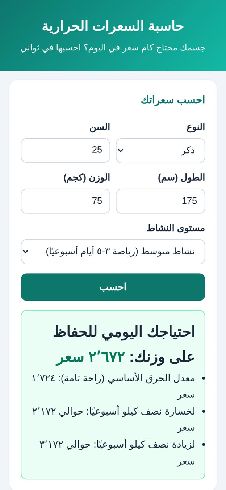

# Daily Calorie Calculator | حاسبة السعرات الحرارية

Estimate your daily calorie needs with the Mifflin-St Jeor equation from your age, height, weight and activity level, with targets for losing or gaining half a kilo per week. Arabic interface.

**Live app:** https://abood-ayman.github.io/calories-calculator-ar/

**LinkedIn:** [Project entry](https://www.linkedin.com/in/abdullah-ayman-1678b737b/details/projects/)

This is a personal project, built with AI tools.

## Features
- Basal metabolic rate (BMR) via the Mifflin-St Jeor equation
- Daily needs across five activity levels, sedentary to very active
- Calorie targets for losing or gaining half a kilo per week
- Instant results for men and women

## Note
These are estimates and can differ from your actual needs depending on body composition and health. Do not follow a very low-calorie diet without consulting a doctor or dietitian.

## Privacy
Everything runs in your browser. No data is stored or sent anywhere.

## Run locally
Open `index.html` in any browser. It is a single static page with no dependencies.

## Status
Stable.

## Copyright
MIT License - Copyright (c) 2026 Abdullah Ayman.
